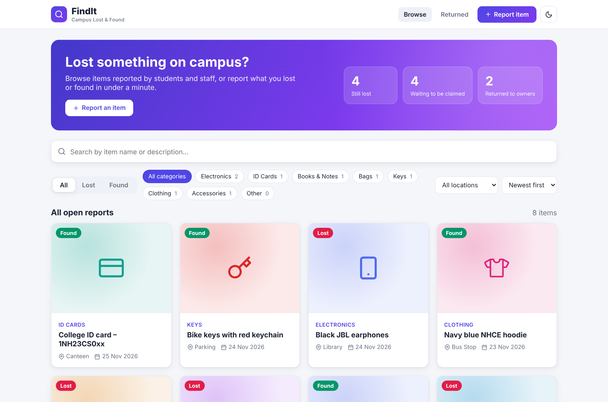
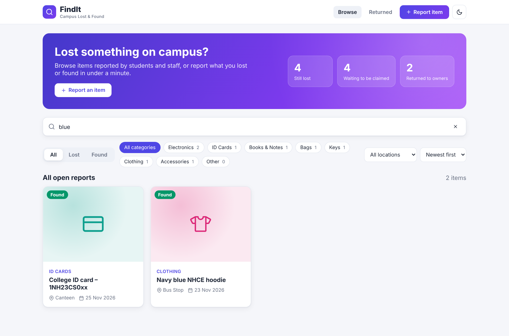
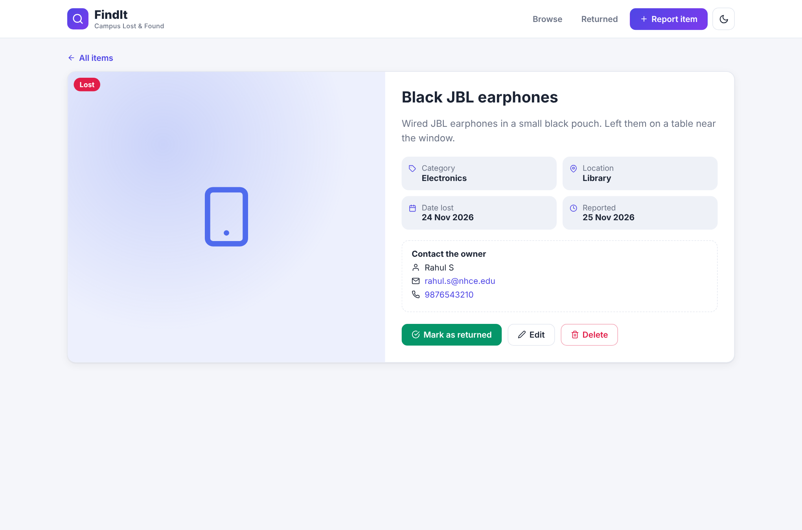
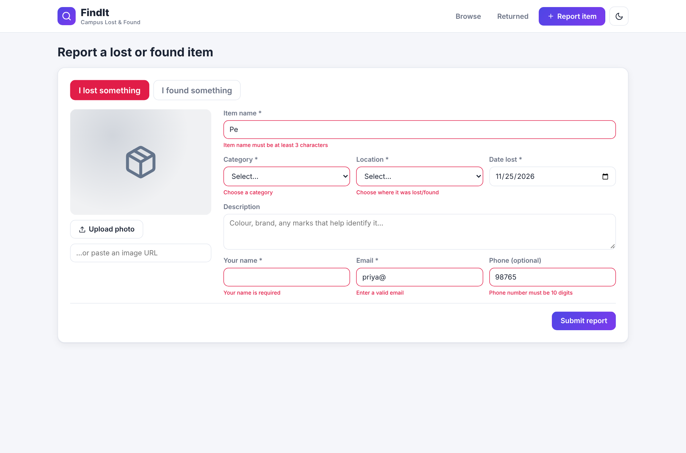
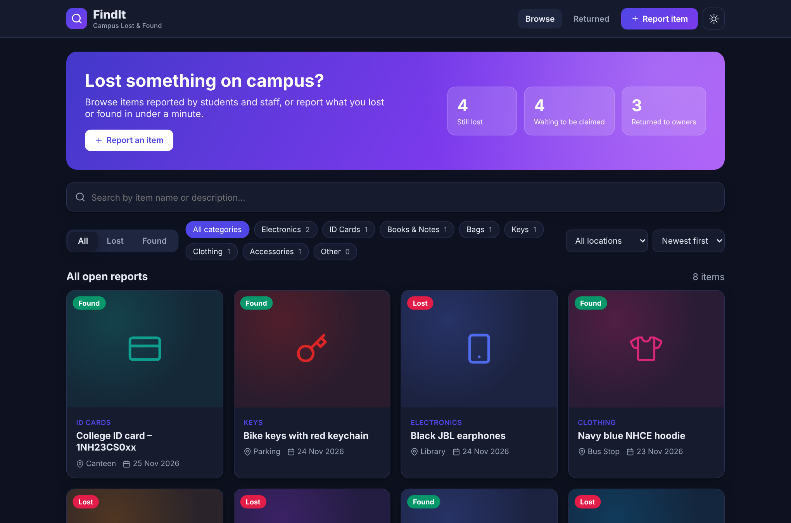

# FindIt – Campus Lost & Found (MERN)

A full-stack MERN web application where students and staff report items they **lost** or **found** on campus, search and filter the reports, contact the owner/finder, and mark items as **returned**.

Built for **Full Stack Technologies (22CSE71) – AAT-2** by **Naveen M (1NH23CS165)**, New Horizon College of Engineering.



## Features

- Report a lost or found item with name, category, location, date, description, contact details and an optional photo
- Photo upload is resized in the browser (max 900 px) before saving; image links are also supported
- Search by item name or description; filter by Lost/Found, category chips (with counts), location; sort by date
- Item details page with contact links (email / phone), **Mark as returned** / **Reopen**, Edit and Delete
- Returned page listing closed reports; live counts in the header (still lost, waiting to be claimed, returned)
- Validation in the browser **and** on the server (Mongoose validators), with clear error messages
- Light/dark theme (remembered in the browser) and responsive layout for phones

## Tech Stack

| Layer | Technology |
|-------|------------|
| Frontend | React 18 (Vite), React Router 6, react-icons, CSS3 (variables, grid, flexbox) |
| Backend | Node.js, Express 4 (cors, express.json, error-handling middleware) |
| Database | MongoDB with Mongoose 8 (schema, validators, timestamps) |
| Tools | VS Code, npm, Git & GitHub |

## Project Structure

```
FindIt/
├── client/                     # React front end (Vite)
│   ├── index.html
│   ├── vite.config.js          # proxies /api to http://localhost:5000
│   └── src/
│       ├── main.jsx            # BrowserRouter + App
│       ├── App.jsx             # routes, theme, toast notifications
│       ├── api.js              # all fetch() calls to the API
│       ├── index.css
│       ├── components/         # Navbar, SearchBar, Filters, ItemCard, ItemImage, ItemForm
│       └── pages/              # Home, ItemDetails, ReportItem, EditItem, Returned, NotFound
├── server/                     # Express + MongoDB back end
│   ├── index.js                # app setup, middleware, MongoDB connection
│   ├── models/Item.js          # Mongoose schema and validation
│   ├── routes/items.js         # REST routes (CRUD, search, stats, resolve)
│   ├── middleware/errorHandler.js
│   ├── seed.js                 # sample data
│   └── .env.example
└── docs/screenshots/
```

## Getting Started

Requirements: **Node.js 18+** and **MongoDB** running locally (or a MongoDB Atlas connection string).

```bash
# 1. API server
cd server
npm install
cp .env.example .env          # edit MONGO_URI if needed
npm run seed                  # optional: load sample items
npm run dev                   # http://localhost:5000

# 2. React client (new terminal)
cd client
npm install
npm run dev                   # http://localhost:5173
```

## REST API

| Method | Endpoint | Description |
|--------|----------|-------------|
| GET | `/api/items?q=&type=&category=&location=&status=&sort=` | List / search items (default `status=open`; use `all` or `resolved`) |
| GET | `/api/items/stats` | Counts for lost, found, returned and per category |
| GET | `/api/items/:id` | One item |
| POST | `/api/items` | Create a report |
| PUT | `/api/items/:id` | Update a report (validators run) |
| PATCH | `/api/items/:id/resolve` | Toggle open ↔ returned |
| DELETE | `/api/items/:id` | Delete a report |
| GET | `/api/meta` | Category and location lists |
| GET | `/api/health` | Server and database status |

Errors are returned as JSON `{ "message": "..." }` with status **400** (validation / invalid id / bad JSON), **404** (not found), **413** (photo too large) or **500**.

## Screenshots

| Search & filters | Item details |
|---|---|
|  |  |
| **Form validation** | **Dark theme** |
|  |  |

## Author

**Naveen M** – USN 1NH23CS165 – Dept. of CSE, New Horizon College of Engineering
